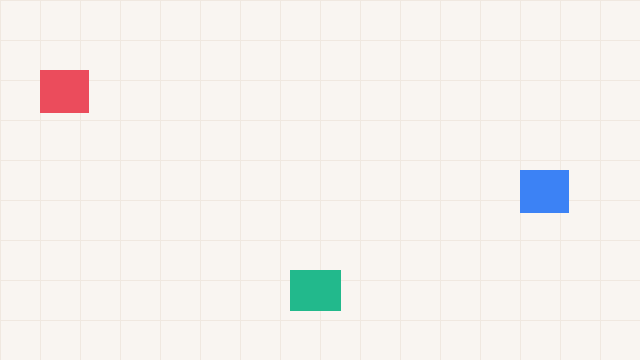

# SceneGraph Video Lab

**视频 → 时序场景图 → 对象级编辑 → 视频重建 / 可选 Diffusion 接口。**

[在线交互展示](https://dellya-zhang.github.io/scenegraph-video-lab/) · [面试讲解与技术边界](INTERVIEW.md)

本项目是为讲解视频理解与生成链路补做的独立最小复现，并非本科毕设原始代码或原始实验结果。不包含模型训练、真实场景识别或已验证的 Diffusion 生成效果。



## 快速启动

Python 3.10+，普通 CPU 可运行，无需密钥。

```bash
pip install -r requirements.txt
python pipeline.py
python -m unittest discover -s tests -v
python -m http.server 8020 --directory docs
```

浏览器访问 http://localhost:8020 。点击播放、拖动时间轴、移除某个对象、下载编辑后的场景图。

```bash
# 可选：读入自己的短视频（最多600帧），检测器仅支持演示三色对象
python pipeline.py --input your_video.mp4 --out outputs/custom
# 仅导出条件文本，不下载模型
python diffusion_adapter.py --dry-run
# 有兼容 CUDA GPU 和足够内存、同意模型许可后，尝试预训练模型推理
pip install -r requirements-diffusion.txt
python diffusion_adapter.py --output outputs/diffusion.mp4
```

Diffusion 适配器参考 [Hugging Face 官方 CogVideoX 文档](https://huggingface.co/docs/diffusers/en/api/pipelines/cogvideox)，使用 `THUDM/CogVideoX-5b-I2V`。本机无 torch / CUDA，**仅验证了条件导出，未验证模型加载、显存需求和生成效果**。可选依赖为范围约束，尚未提供经过 GPU 验证的锁文件。默认生成使用原始图的首帧；使用编辑图时必须同时提供匹配的首帧图。

## 链路与产物

| 阶段 | 实现 | 可检查产物 |
|---|---|---|
| 输入 | 60帧、12fps、640×360 程序化三色视频帧；另支持 OpenCV 读视频 | `docs/assets/input.gif` |
| 检测 | RGB距离阈值 + 连通域；非学习模型 | 归一化 bbox、颜色类别 |
| 跟踪 | 同色对象最近中心、80像素门限；无重识别和遮挡恢复 | 持续 track ID |
| 图构建 | 每帧节点、left_of/right_of、above/below、near | `docs/assets/graph.json` |
| 图编辑 | 删除节点及全部关联边 | `edited_graph.json` |
| 重建 | 根据 bbox 与颜色逐帧绘制，无原像素复制 | `reconstruction.gif` / `edited.gif` |
| 生成接口 | 初末图关系编译为文本 + 首帧图 → CogVideoX I2V | `diffusion_adapter.py`；尚未执行模型推理 |

场景图保留逐帧位置和关系，但不保留纹理、深度或复杂运动；因此是有损中间表示。网页输入画布以检测框复绘，原始输入 GIF 可通过页面链接查看。JSON 为 Python 实际运行输出，网页不运行模型。浏览器与 Python 采用同一 bbox 坐标约定。

## 图结构

```json
{"frame":0,"time":0.0,"nodes":[{"id":1,"label":"red_object","color":"red","bbox":[0.0625,0.19444,0.07656,0.11944]}],"edges":[]}
```

`bbox=[x/W,y/H,w/W,h/H]`。节点ID用于跨帧关联，边为帧内关系。颜色类别只适用于当前合成样例；采样稀疏、快速移动、相同颜色交叉或遮挡会造成ID切换。当前输入读取最多600帧，长视频需分段处理。

## 生成端的真实边界

本项目没有图条件 Diffusion 训练。关系文本和首帧是**间接条件**，不能保证复杂时序关系、轨迹和对象身份。严格控制应进一步研究图编码器、逐帧布局条件、交叉注意力注入及时间一致性损失，并用 relation satisfaction、ID switch、轨迹误差等指标验证。不能将本项目称为已实现的端到端图生视频模型。

MIT 授权适用于本仓库代码；预训练模型遵守其独立许可证。样例素材由程序创建。
